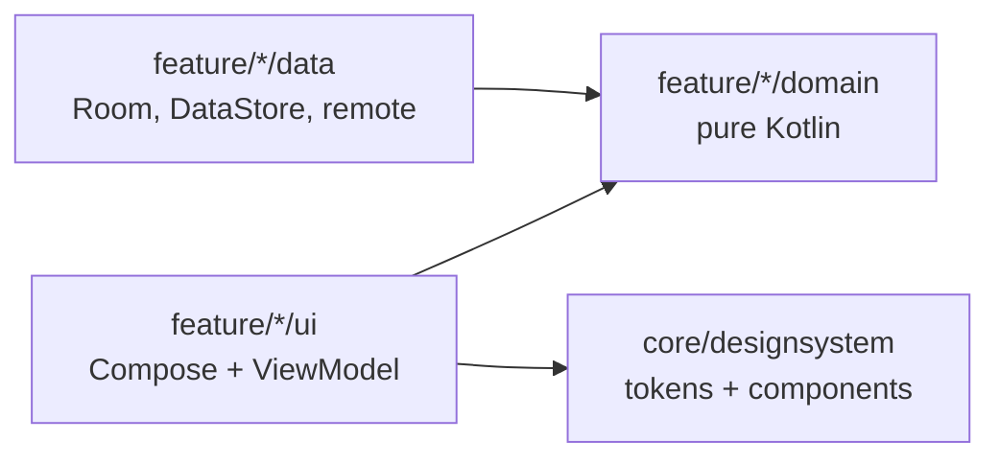

# Findora · Dream House

> Where comfort meets convenience. A production-minded Android rental app built with Kotlin and Jetpack Compose.

[](https://github.com/bileldh-ing/findora/actions/workflows/ci.yml)
[](https://github.com/bileldh-ing/findora/actions/workflows/release.yml)
[](https://github.com/bileldh-ing/findora/releases)


Findora is built in small, verifiable phases. Every phase must compile and pass
`./gradlew check` (detekt, Spotless/ktlint, unit tests, Android Lint with warnings as errors)
before the next one starts. The [changelog](CHANGELOG.md) records what each phase delivered.

## Roadmap

| Phase | Scope | Status |
|---|---|---|
| 0 | Bootstrap: build system, design system, navigation, CI | Done |
| 1 | Data layer and property imagery | Done |
| 2 | Welcome and authentication | Done |
| 3 | Home screen, pixel-faithful to the reference design | Done |
| 4 | Property detail (gallery, agent contact, share links, similar homes, price history, neighbourhood radar, affordability calculator) and viewing bookings (slots, reminders, calendar, My viewings) | Done (v0.5.0) |
| 5 | Best-match recommendations: preference quiz, explainable match score, Best match sort (5A); Dream Match swipe deck and side-by-side Compare (5B); Ask Findora natural-language search (5C) | Done (v0.6.0) |
| 6 | Map, chat, settings, localisation (EN, FR, AR with RTL): Locations map (6A); chat with agents and notifications center (6B); complete Settings with per-app language, display currency, units, notification, accessibility and privacy controls (6C) | Done (v0.7.0) |
| 7 | Pro extras: saved-search alerts and the "Findora picks" widget (7A); owner mode and adaptive layouts for tablets, foldables and landscape (7B) | Done (v0.8.0) |
| 8 | Polish and ship: Baseline Profile, startup Macrobenchmark, Compose stability, StrictMode/LeakCanary, accessibility checks and screenshot tests (8A); release polish (8B) | In progress (8A) |

## What Phase 8A ships

Performance and quality gates (details in [docs/PERFORMANCE.md](docs/PERFORMANCE.md) and [docs/TESTING.md](docs/TESTING.md)):

- **Baseline Profile** from the critical journey (cold start → Home scroll → listing detail → back), generated on the CI emulator by the `:baselineprofile` module and installed by `profileinstaller`.
- **Startup Macrobenchmark**: cold and warm start and Home-scroll frame timing of the minified build, no AOT vs Baseline Profile, on every CI run (informational on the emulator; absolute numbers need a physical device).
- **Compose stability**: strong skipping on, the hot screen states `@Immutable`, compiler reports behind `-PcomposeMetrics`.
- **R8** release shrinking verified by the release build and by running the minified benchmark build on the emulator.
- **Debug diagnostics**: StrictMode (log only) and LeakCanary in debug builds.
- **Accessibility checks**: Google's Accessibility Test Framework on Welcome, Home, detail, chat and Settings in an instrumented test.
- **Screenshot tests**: Roborazzi goldens of the five key screens in light/dark and LTR/RTL, verified on CI.

Measured on the CI emulator (API 34, software rendering, so relative numbers only): cold start time to initial
display about 1.8 s, warm start about 0.6 s, before the app's own profile was committed. The spec's 800 ms cold-start
target still has to be checked on a physical mid-range device; see [docs/PERFORMANCE.md](docs/PERFORMANCE.md).

## What Phase 7B ships

- **Owner mode**: switch it on in Settings (signed-in accounts; guests are asked to create one) to reach the **Owner
  dashboard**: total views, saves and enquiries, a 14-day views bar chart, My listings with Draft / Published /
  Paused status and per-listing stats, and the enquiries other users sent. Pause, unpublish and delete ask first.
- **List your property**: a seven-step wizard (basics, location with a map pin, details, amenities, photos, price
  and deposit, preview) with inline validation per step (`ListingValidator`), autosaved drafts and Publish. Photos
  come from the system Photo Picker (no storage permission) and are downscaled to 1600 px, compressed and kept in
  app-private storage; reorder, remove and choose the cover.
- **Listings stay on the device**: a published listing is written into the local listings cache with its owner id,
  so every user of the device sees it in Home, search, the map and detail pages; the owner sees "Listed by you" and
  Edit listing. Market refreshes never touch owner listings. Room schema v5 (auto-migration, tested).
- **Adaptive layouts**: window size classes pick the floating pill (compact) or a navigation rail (medium and
  expanded), 2 / 3 / 4 Home columns, list-detail panes for Home → listing and Chat → conversation and two-pane
  Settings on expanded widths, hinge-aware panes on book-posture foldables, and landscape-safe Welcome and sign-in.
- **Known limitation**: messages to an owner's listing are answered by the automated demo assistant and listed in the
  owner's dashboard; the owner cannot reply from their account, because two-party messaging between accounts needs a
  backend that Findora does not have yet.

## What Phase 7A ships

- **Saved searches with alerts**: "Save search" on a filtered Home feed and "Save this search" in Ask Findora; the
  Saved tab's **Searches** list runs, renames and deletes them and sets new-match alerts (Daily or On every refresh).
  Listings that already match when a search is saved never alert; each new one alerts once (`AlertDiff`,
  `CheckSearchAlerts`, seen ids in Room v4).
- **Background checks**: `SearchAlertWorker` every 4 hours (battery not low; no network constraint because the
  backend is local) plus a one-off check of instant searches after each listings refresh; favourites that got
  cheaper are reported too. Entries go to the notifications center and to the **Search alerts** channel, each
  honouring its Settings toggle and `POST_NOTIFICATIONS`. A new-match notification opens
  `findora://search/{id}`, which applies the search to Home for its owner only.
- **A market that moves over time**: the fake backend (`FakeMarket`) deterministically publishes two new units per
  region every day (09:00 and 13:00 UTC, listed for a week) and offers about one listing in eight 5% cheaper each
  week, so alerts have real, reproducible events.
- **"Findora picks" widget** (Jetpack Glance): the top three homes (best matches, else saved homes, else
  Recommended) with photo, price in the display currency and match score, plus the next viewing; taps open the
  listing through `findora://property/{id}`. Light and dark, localized, TalkBack sentences, refreshed by WorkManager
  every 3 hours and whenever favourites or viewings change, with a scalable picker preview on Android 12+.

## What Phase 6C ships

- **Language**: a per-app picker (System, English, Français, العربية) built on `AppCompatDelegate.setApplicationLocales`.
  On Android 13+ the choice also appears in the system's per-app language settings (`locales_config.xml`,
  `android:localeConfig`); below 13 AppCompat stores it (`autoStoreLocales`). The activity is recreated at once, so
  text and RTL mirroring flip immediately. Notifications, the reminder worker and the demo agent's replies resolve
  their strings through the same language.
- **Display currency**: Listing currency (default) or INR, USD, EUR, TND. Conversions use a bundled, dated table of
  indicative rates (`assets/rates/exchange_rates.json`, labelled "Indicative rates as of …" in Settings and About)
  and a pure-Kotlin `CurrencyConverter` (BigDecimal, cross rate at 10 decimals HALF_EVEN, results HALF_UP to whole
  units). Converted amounts carry a "≈" prefix on cards, the detail price, compare (including price per area), map
  pills, the chat card and agent replies. **Affordability stays in the listing currency** (income, rent and
  results are compared like for like); when a display currency is set the sheet says so and shows the "≈"
  equivalent of the rent. The filter and quiz sliders still move in listing currency, with converted labels; the
  price-history chart stays in the listing currency.
- **Units**: square metres or square feet everywhere an area appears (cards, map cards, detail, Dream Match, compare,
  filter sheet, agent replies, TalkBack). Ask Findora keeps parsing both "80 m²" and "900 sq ft".
- **Notifications**: separate toggles for message notifications, viewing reminders and in-app notifications, honoured
  by the demo agent, the reminder worker and booking confirmations, plus a shortcut to the system settings.
- **Accessibility**: a reduce-motion override (System / On / Off) feeding the shared reduced-motion helper, and a
  text-size preview that shows the current system font scale.
- **Privacy and data**: clear search history, clear cache (Coil memory and disk caches and the map tile cache),
  export my data (profile, preferences, favourites, viewings, chats and recent searches as JSON through the system
  "Save as" picker), the privacy policy and an **About** screen (version, exchange-rate source, OpenStreetMap
  attribution, Pexels photo credits generated from `CREDITS.md` by `scripts/build_licenses`, open-source licences).

## What Phase 6B ships

- **Chat tab** (fifth item of the floating nav pill, with an unread badge): one thread per listing with its
  agent, last message preview, time and unread count. **Message agent** on the listing's agent card and on the
  "Viewing booked" screen (where a Dream Match super like lands) opens the thread; it is created by the first
  message, so the list never holds empty threads.
- **Conversation screen**: the listing card pinned at the top, bubbles grouped by day, delivery ticks
  (sending, sent, read), a typing indicator, quick replies ("Is it still available?", "Can I visit this week?",
  "Is the price negotiable?") and a composer. Mirrored for Arabic, light and dark, every bubble read by
  TalkBack as one sentence with sender, time and delivery state; the typing dots stay still with animations off.
- **Demo agent, clearly labelled "Demo agent — automated replies"**: `AgentReplyEngine` (pure Kotlin,
  deterministic) answers from the listing's own data only: availability and days on the market, open viewing
  times from `ViewingSlotGenerator` (taken and busy slots are never offered; "tomorrow" and "this week" are
  understood), the rent and how negotiable it is (from its price history and age), pets, parking, furnishing and
  size, in English, French or Arabic. Replies arrive after a human-looking delay through an app-scoped
  coroutine; nothing leaves the device.
- **Notifications center** (Home bell, whose blue dot now counts real unread entries): new agent messages,
  viewing booked and viewing reminders, stored per user in Room. Tap opens the thread or listing and marks it read;
  "Mark all read"; swipe (or the TalkBack "Delete" action) removes one. A reply to a thread that is not on screen
  also posts a system notification on a new **Messages** channel (only with `POST_NOTIFICATIONS`, asked with the
  first message of a thread on Android 13+); its `findora://chat/{id}` link goes through the same route guard as
  listing links and opens only for the thread's owner.
- **Room schema v3** (auto-migration from v2, tested with `MigrationTestHelper`): `conversations`, `notifications`
  and a `status` column on `messages` (existing rows default to "sent").
- Price-drop notifications are not included: listing prices only change between seed versions, so there is no
  real event to notify about yet.

## What Phase 6A ships

- **Locations map**: an OpenStreetMap map (osmdroid, no API key, [ADR 0005](docs/adr/0005-openstreetmap-with-osmdroid.md))
  centred on the current region, with price-pill markers that merge into count bubbles when zoomed out
  (pure-Kotlin grid clustering, tap a bubble to zoom in) and the selected home highlighted.
- **Card carousel** under the map kept in sync with the markers: swipe a card and the map pans to it, tap a pill
  and the carousel scrolls to its card, tap a card to open the listing. Match badges appear with a preference profile.
- **Search this area** after panning or zooming by hand, the **Home filter** applied to the map, a **region
  switcher**, a **list / map toggle** (the accessible alternative to the map) and **My location** (approximate
  location only, asked on tap, never in the background, no Google Play services).
- Works offline for listings (Room); a banner explains when map tiles cannot load. Dark map, RTL carousel,
  English, French and Arabic, TalkBack actions for every marker.

## What Phase 5C ships

- **Ask Findora** (a second mode of the Search screen, next to Places): type or dictate a sentence such as
  "quiet 2 bedroom near Fort Kochi under 15k with parking", "T3 meublé à La Marsa moins de 2 000 DT" or
  "شقة غرفتين في المرسى أقل من ٢٠٠٠ دينار" and Findora shows what it understood as removable chips
  ("Under 2,000 TND", "2+ bedrooms", "La Marsa", "Pets OK"), the words it did not understand, and notes when the
  sentence switches region or names a currency the region does not use. **Show homes** replaces the Home filter
  with the result (switching region when a neighbourhood, region or currency points elsewhere) and orders it by
  Best match when the user has a preference profile, unless the sentence asked for an order ("cheapest",
  "newest", "top rated"). When nothing is understood it says so and offers to search the words as plain text.
  Example prompts are shown in the current language.
- **On-device and rule-based, not generative AI** (see [ADR 0004](docs/adr/0004-match-engine-and-natural-language-search.md)). `NaturalLanguageQueryParser` (`core/domain/search`, pure
  Kotlin) is a deterministic tokenizer plus grammar rules over an English, French and Arabic lexicon. No text
  leaves the phone, there is no model and no API key, and the same sentence always gives the same filter. The
  screen says so. It understands:
  - numbers in ASCII, Arabic-Indic (٠-٩) and Persian (۰-۹) digits, with thousands groups ("2 000", "2,000",
    "2.000"), decimals ("1,5k"), multipliers ("2k", "2 lakh", "deux mille", "٢ ألف", "ألفين") and spelled-out
    counts ("two", "trois", "ثلاث");
  - budgets: under / below / max / up to / around, moins de / sous / jusqu'à, أقل من / تحت / حوالي, at least /
    au moins / على الأقل, ranges ("between 1 500 and 2 000", "de 800 à 1200", "بين ١٠٠٠ و ٢٠٠٠", "1.5-2k"),
    bare amounts with a currency or multiplier, and currency symbols, codes and names (₹ Rs, €, $, DT/TND/دينار,
    AED/درهم);
  - bedrooms and bathrooms ("2 bedrooms", "3BHK", "3+ beds", "2-bedroom", "chambres", "غرفتين", "٣ غرف نوم",
    "حمامين"), French T/F notation and "pièces" (T3 = 3 rooms including the living room = 2 bedrooms), areas
    (m², sqm, sq ft converted);
  - types (apartment / flat / studio / appartement / شقة, house / villa / maison / فيلا / منزل, room /
    colocation / غرفة), must-haves (furnished / meublé / مفروش, pets / animaux / حيوانات أليفة, parking /
    موقف, verified) and amenities (balcony, pool, gym, Wi-Fi, air conditioning, garden, sea view, lift,
    security, home office, washing machine);
  - neighbourhoods and regions of the region packs, accent- and case-insensitive, with Arabic and common
    aliases (المرسى, قرطاج, نخلة جميرا, Cochin, JVC) and a small typo allowance on canonical names (one edit, two
    for names of nine letters or more, first letter must agree, never on short aliases);
  - lifestyle words (quiet, family, near metro / transport, student, nightlife, nature, remote work), which the
    listings cannot filter on: they are shown as "Hint" chips and ask for Best match, which weighs the user's own
    lifestyle answers (without a profile the screen suggests the quiz).
  Negated phrases ("no pets", "sans parking", "غير مفروش"), an upper bound on rooms ("max 2 bedrooms", which the
  filter cannot express) and contradictions ("under 2000 under 1500") are reported as not understood instead of
  being applied the wrong way round.
- **Voice input**: a microphone button hands off to the system speech recognizer (`RecognizerIntent`) in the
  app language. Findora requests no microphone permission; the button only appears when a recognizer is
  installed (`<queries>` declaration). The recognizer belongs to the device and may process audio according to
  its provider's own policy; only the recognized text reaches Findora, where it is parsed on the device.
- English, French and Arabic strings and examples, RTL, light and dark, TalkBack labels ("Remove Pets OK").

## What Phase 5B ships

- **Dream Match** (`feature/match/deck`, `DreamMatch` route, from a card on Home and on the Saved tab): the
  current region's homes as a stack of cards, Best match order with a profile (must-have failures left out) and
  Home's Recommended order without one. Homes already saved, or skipped in an earlier session, are left out.
  Drag the top card (it tilts with the drag and SAVE / SKIP / SUPER LIKE stamps fade in); it commits past 30% of
  the width (20% of the height upwards) or above a 1000 dp/s fling, otherwise it springs back.
  - Right / Save: added to favourites and to the **Matches** collection, recorded as `save_deck`.
  - Left / Skip: recorded as `skip_deck`, which `BehaviorAffinity` weighs at -1.5 (a dismissal is -2), so similar
    homes score a little lower in learned behaviour.
  - Up / Super like: saved like Save (`super_like_deck`, weighted like contacting an agent), then the Schedule a
    viewing screen opens for that home (Findora has no chat yet).
  - Undo reverts the last action, repeatedly: the event is deleted and a favourite the deck added is removed
    (one the user already had is kept). "n / total" progress with an animated bar, haptics on commit
    (`LongPress`) and when a drag crosses the threshold (`TextHandleMove`). End of deck: "See my matches" and
    "Start again" (which deals the skipped homes again).
  - Accessibility: every gesture has a button (Undo, Skip, Super like, Save, 48 to 64 dp) and the card offers
    Save, Skip and Super like as TalkBack custom actions; the progress is announced politely. With animations
    off, cards move instantly and do not tilt.
  - **RTL decision**: swipe directions are physical. Right always saves and left always skips, in Arabic too,
    and the action buttons keep the left-to-right order (Skip on the left, Save on the right) so each button
    sits on the side its swipe goes. Labels and the rest of the screen mirror normally.
- **Matches**: a Saved / Matches switch on the Saved tab and a standalone Matches page ("See my matches").
  Matches are derived from the deck events (`save_deck`, `super_like_deck`) intersected with the current
  favourites, newest first, so un-saving a home also removes it from Matches. No new table: Room stays at
  schema v2 (only two new DAO queries over `interaction_events`).
- **Compare** (`feature/compare`, `Compare` route): "Add to compare" in the detail page's top bar (it toggles)
  and as a long press (and TalkBack action) on Home cards; at most 3 homes, with a snackbar when full and a
  "View" action. A floating tray above the navigation pill shows the picked homes, "n / 3 selected", Clear and
  Compare. The Compare screen is a side-by-side table: photo, price, area, price per m², bedrooms, bathrooms,
  amenity count, rating and match score (with a profile), the best value per row highlighted (ties share it,
  nothing is highlighted when all are equal, prices in different currencies are never ranked), then an amenity
  checklist. Columns are removed with their close button and reordered by long-press dragging a header
  (mirrored in RTL), by arrow buttons or by TalkBack actions. The selection is per user and kept in memory for
  the session (`InMemoryCompareRepository`): it is a short-lived working set, so it is not persisted.

## What Phase 5A ships

- **Preference quiz**: six short steps (budget, beds and baths, home types, neighbourhoods or a commute
  destination, lifestyle, must-haves) with an animated progress bar, Back and Skip. Home shows a "Find my best
  match" banner until a profile exists; Settings > Match preferences edits it.
- **Best Match engine** (`core/domain/match`): `MatchScoreCalculator` is pure and deterministic and returns
  `MatchResult(score 0..100, reasons)` from seven weighted factors (budget 30, location or commute 20, size 15,
  amenities and must-haves 15, lifestyle 10, trust and freshness 5, learned behaviour 5). A missing must-have
  scores 0 and leaves the home out of Best match. Behaviour is learned from the recorded interactions with an
  exponential decay (half-life 14 days, injected clock).
- **Explainable UI**: "92% match" badges on cards (only with a profile, read by TalkBack), a "Best match" sort,
  an animated match ring with the top three reasons on the detail page and a "Why this match?" sheet with an
  animated bar per factor.
- **Why DataStore, not Room, for the profile**: it is one small document per user, always read and written
  whole and never queried or joined, so a Room table would only add a schema version and a migration. It is
  stored as versioned JSON (`PreferenceProfileDto`) in the existing Preferences DataStore, keyed by user id.

## What Phase 3 ships

- **Home, as in the reference**: location pill (region picker), bell with an unread dot (notifications
  sheet, swipe to mark read), initials avatar, "Discover / Your New House", search pill with a filter badge,
  sliding category chips and a two-column grid of glass-chip cards. The title collapses as you scroll and a
  compact search bar pins to the top.
- **Paging 3 over Room**: the shared `PropertyFilter` becomes one parameterised SQL query
  (`PropertyQueryBuilder`, unit-tested clause by clause) behind a `@RawQuery` PagingSource. Pull to refresh,
  shimmer skeletons, empty, error and offline states.
- **Filters**: rent and area sliders bounded by the region's listings, bedrooms, bathrooms, furnished, pets,
  parking, verified, amenities and five sort orders; the badge counts active refinements.
- **Search** with 300 ms debounced suggestions and per-user recent searches (swipe to delete, clear all).
- **Favourites** per user: heart toggle, double-tap with a heart burst, and a Saved tab.
- **Floating navigation pill** (Home, Locations, Saved, Settings) with a sliding spring indicator.
  Locations became a map in Phase 6A; the Chat tab joined in Phase 6B.
- Staggered card entrance and `animateItem`, all skipped when system animations are off; TalkBack reads one
  summary per card with Save as a custom action.

## What Phase 2 ships

- **Welcome**, faithful to the reference: full-bleed hero photo cut by a concave arc (`ConcaveArcShape`,
  `Path.quadraticTo`), logo badge, FINDORA / Dream House over a soft scrim, WELCOME in Syne, subtitle,
  Login and Sign Up pills, plus "Try demo account" and "Continue as guest". Ken Burns drift, a bouncy badge,
  staggered entrance and photo parallax on scroll, all skipped when system animations are off.
- **Login, Sign Up, Forgot password** with inline validation (e-mail format, password rules checklist,
  matching confirmation), "Remember me", a 5-failure / 30-second lockout with a live countdown, and a local
  reset-code flow (no e-mail is sent; the code is shown in-app).
- **Local auth** (`core/data/auth`, see [ADR 0003](docs/adr/0003-local-authentication.md)): PBKDF2WithHmacSHA256
  (16-byte salt, 120,000 iterations, constant-time compare), case-insensitive unique e-mail, persisted
  throttling (Room schema v2 auto-migration), session token encrypted with an Android Keystore AES-GCM key,
  30-day remembered sessions, guest sessions, the pre-seeded demo account `demo@findora.app` / `Demo1234`,
  logout and delete account (removes every row keyed by the user id).
- **Route guard**: a valid session at launch skips Welcome; with the biometric lock on, the app opens on an
  Unlock screen (`androidx.biometric`, fingerprint/face or screen lock).
- **Settings (first cut)**: account card, theme (system/light/dark, applied app-wide), biometric lock toggle,
  log out, delete account with confirmation (now the Settings tab).
- English, French and Arabic strings for everything; icons are a thin-stroke set drawn in code, with
  auto-mirroring for directional icons in RTL.

## What Phase 1 ships

- **Domain** (`core/domain`, pure Kotlin, `@Immutable` models): `Property`, `PropertyType`, `Agent` with an
  initials avatar, `Amenity`, `PricePoint`, `Money`/`Currency` (INR, USD, EUR, TND, AED), `RegionPack`
  (Kerala default, Tunis, Paris, Dubai), settings, and repository interfaces.
- **Sample dataset**: 64 fictional listings (40 in Kerala, 8 each in Tunis, Paris and Dubai) in
  `app/src/main/assets/seed/`, including the four design listings (Georgie House, Max House, Luna Haven,
  The Serene Nest). Every listing is labelled `sampleData`; agents, phones and prices are invented.
- **Real photography**: 204 distinct Pexels photos (4 to 8 per listing, unique cover per listing), each
  verified at build time (HTTP 200, image content type, long side of at least 1200 px, not black and white,
  no duplicate bytes or near-duplicate dHash) with a dominant colour for instant placeholders.
  Credits in [CREDITS.md](CREDITS.md) and on every image in the seed. A 12-photo WebP offline pack
  (1.9 MB, max 1280 px, quality 85) backs every image so cards never render empty.
- **Data layer** (`core/data`): Room database with entities and DAOs for properties, per-user favourites,
  users, messages, saved searches, viewings (double booking blocked by a unique index), recent searches and
  interaction events, exported schemas in `app/schemas`; DataStore settings; `FakeRemoteDataSource` with
  150 to 600 ms latency and switchable error injection; offline-first repositories. See
  [ADR 0002](docs/adr/0002-offline-first-data-layer.md).
- **Images** (`core/image`): Coil 3 `ImageLoader` with a 250 MB disk cache, 25% memory cache, crossfade,
  OkHttp, and an interceptor that falls back to the bundled WebP when a remote load fails.
- **PriceFormatter**: design style `10.000/ Month`, plus locale-aware formats (lakh grouping for INR,
  French spacing for EUR/TND, Arabic conventions and RTL-safe isolation).

### Regenerating the seed

```bash
pip install pillow
python3 scripts/build_seed/build_seed.py                  # regenerate listings, regions, CREDITS.md
python3 scripts/build_seed/build_seed.py --refresh-photos  # re-download and re-verify every photo
python3 scripts/build_seed/build_seed.py --offline-pack    # rebuild the WebP offline pack
python3 scripts/build_seed/build_seed.py --check           # fail if committed outputs are stale (offline, runs in CI)
```

## What Phase 0 ships

- **Build system**: Gradle Kotlin DSL, a single version catalog, KSP only (no kapt).
- **Design system** (`core/designsystem`): light and dark colour roles, a Syne + Poppins type scale,
  spacing, shape, elevation and motion tokens exposed through `CompositionLocal`s, plus a WCAG 2.1
  contrast helper with unit tests on the key text/background pairs.
- **Components**: pill buttons, category chips, glass chips, logo mark and badge.
- **App shell**: Hilt, type-safe Navigation Compose routes (kotlinx.serialization), Android 12
  splash screen back-ported to API 26, adaptive and themed launcher icon, edge-to-edge,
  predictive back, French and Arabic strings with RTL enabled.
- **Debug-only design-system showcase**, absent from release builds (covered by a test).
- **Quality gates**: detekt with Compose rules, Spotless/ktlint, Kover coverage,
  Android Lint with warnings as errors, and GitHub Actions CI that also builds an R8 release APK.

## Getting started

Requirements: JDK 17 and Android SDK 35.

```bash
git clone https://github.com/bileldh-ing/findora.git
cd findora
./gradlew :app:installDebug          # build and install on a running emulator or device
./gradlew check                      # detekt + spotlessCheck + unit tests + Android Lint
./gradlew :app:koverHtmlReportDebug  # coverage report
./gradlew spotlessApply              # auto-format
```

## Architecture

Single `:app` module organised package-by-feature; the reasoning is in
[ADR 0001](docs/adr/0001-single-module-package-by-feature.md).



```text
app/src/main/java/com/findora/app
├── core
│   ├── designsystem/theme      colours, type, tokens, contrast, FindoraTheme
│   ├── designsystem/component  pill buttons, chips, logo, text fields, arc shape, controls
│   ├── designsystem/icon       thin-stroke icon set (ImageVector)
│   ├── common                  injectable clock
│   ├── domain                  models, repository interfaces, PriceFormatter, map clustering, demo agent rules (pure Kotlin)
│   ├── data                    Room, DataStore, seed DTOs, fake remote, repositories, demo agent responder, Hilt modules
│   ├── notification            Messages channel notifier
│   ├── data/auth               password hashing, Keystore session cipher, local AuthRepository
│   ├── security                biometric availability
│   ├── image                   Coil ImageLoader and offline fallback
│   ├── ui                      property card, state views, swipe-to-delete row
│   └── di                      coroutine dispatchers module
├── feature
│   ├── auth                    welcome, login, sign up, forgot password, biometric unlock
│   ├── home                    header, paged grid, filter and region sheets
│   ├── chat                    conversation list (Chat tab) and conversation screen
│   ├── notifications           in-app notifications center
│   ├── search                  debounced suggestions and recent searches
│   ├── saved                   saved homes and Dream Match matches
│   ├── compare                 compare tray and side-by-side compare table
│   ├── locations               OpenStreetMap map, synced carousel, list view (clustering in core/domain/map)
│   ├── match                   preference quiz and Dream Match deck (engine lives in core/domain/match)
│   ├── settings                account, match preferences, theme, biometric lock, logout, delete account
│   └── designsystem            debug-only component showcase
└── navigation                  type-safe routes, NavHost, route guard, main shell and floating nav pill
```

## Tech stack

| Dependency | Why |
|---|---|
| Jetpack Compose (BOM) + Material 3 | UI toolkit; Material 3 is re-skinned from Findora tokens |
| Navigation Compose 2.8 | Type-safe routes via kotlinx.serialization |
| Hilt + KSP | Dependency injection without kapt |
| core-splashscreen | Android 12 splash API on API 26+ |
| AppCompat 1.7 | Per-app language (`setApplicationLocales`, stored by AppCompat below Android 13) |
| Room 2.6 (+ KSP, room-testing) | Local single source of truth with exported, migration-tested schemas |
| DataStore Preferences | Async, transactional settings storage that replaces SharedPreferences |
| kotlinx.serialization JSON | Seed and DTO parsing, JSON columns, type-safe routes |
| Kotlin Coroutines + Flow | Async work and reactive streams from Room to UI |
| Coil 3 (compose, network-okhttp) + OkHttp | Image loading with memory/disk cache and crossfade |
| osmdroid | OpenStreetMap raster map view without API keys or Play services, with an on-device tile cache |
| androidx.biometric | Fingerprint, face or screen-lock prompt for the optional app lock |
| Paging 3 (runtime, compose, room-paging, paging-testing) | Incremental loading of the Home feed straight from Room, `LazyPagingItems` in the grid, `asSnapshot` in tests |
| Turbine, MockK, kotlinx-coroutines-test | Flow assertions, mocking and virtual-time coroutine tests |
| Robolectric + Compose UI test | Compose UI tests on the JVM, in CI |
| WorkManager (work-runtime-ktx, work-testing) | Viewing reminders that survive process death and reboots; `TestListenableWorkerBuilder` and the test WorkManager in unit tests |
| Jetpack Glance (glance-appwidget, glance-appwidget-testing) | The "Findora picks" home-screen widget written in Compose style, with JVM unit tests of its content |
| androidx.hilt:hilt-work (+ hilt-compiler) | Constructor-injected `@HiltWorker` workers through `HiltWorkerFactory` |
| Jetpack WindowManager (window, window-core) | `WindowSizeClass` breakpoints for adaptive layouts and the fold / hinge position on foldables |
| androidx.exifinterface | Reads the orientation of picked photos so they are stored upright |
| androidx.profileinstaller | Installs the bundled Baseline Profile so hot startup and scroll code is AOT-compiled |
| androidx.baselineprofile plugin + benchmark-macro-junit4 + UiAutomator | `:baselineprofile` module: generates the Baseline Profile and runs the startup Macrobenchmark on a device |
| LeakCanary (debug only) | Detects leaked activities, view models and views in debug builds |
| Roborazzi (+ compose, junit-rule) | JVM screenshot tests of key screens with committed goldens |
| Accessibility Test Framework | Accessibility Scanner's checks (labels, touch targets, contrast) in instrumented tests |
| detekt (+ Compose rules), Spotless/ktlint, Kover | Static analysis, formatting, coverage |

## Tests

| Suite | Covers |
|---|---|
| `KeyScreensScreenshotTest` | Roborazzi goldens of Welcome, Home, detail, Settings and chat in light/dark and English LTR / Arabic RTL |
| `AccessibilityChecksTest` | Accessibility Test Framework errors on Welcome, Home, detail, chat and Settings (instrumented) |
| `BaselineProfileGenerator`, `StartupBenchmark` | Baseline Profile from the critical journey; cold/warm startup and Home-scroll frames, no AOT vs profile (`:baselineprofile`, device) |
| `DesignTokensTest` | Palette hex values, spacing/radius/motion scales, WCAG AA contrast of key pairs in light and dark |
| `FindoraNavHostTest` | Launch screen, debug showcase navigation and back, no showcase in release |
| `SeedIntegrityTest` | 60+ listings, unique ids, valid fields, 4 to 8 credited images, coordinates inside region bounds, design listings, price history, offline pack size |
| `PriceFormatterTest` | Design style, INR lakh grouping, USD, EUR, TND, Arabic/RTL isolation |
| `DomainModelTest` | Money arithmetic, stable ids, bounds, filters |
| `PropertyDaoTest`, `UserDataDaoTest`, `ActivityDaoTest` | Every DAO against in-memory Room (Robolectric): filters, ordering, per-user favourites, unique e-mail, double-booking guard, recent-search de-duplication and trimming |
| `DatabaseSchemaTest` | Exported schemas committed and identical to the entities; v1 to v5, v2 to v3, v3 to v4 and v4 to v5 migrations keep data (`MigrationTestHelper`) |
| `ListingValidatorTest`, `OwnerStatsCalculatorTest`, `ListingPublisherTest`, `PhotoSizingTest`, `OwnerPhotoAndDraftTest` | Per-step listing rules and bounds; owner stats from other users' activity and the 14-day chart; draft to listing; photo subsampling and sizing; the photo import pipeline with a fake decoder and the draft JSON |
| `RoomOwnerListingRepositoryTest`, `ListingWizardViewModelTest`, `OwnerDashboardViewModelTest` | Owner-scoped listings, publish into the shared cache and survive refreshes, pause / unpublish / delete, signals and enquiries; wizard navigation, validation, autosave, photos and publish (Turbine, virtual time); dashboard stats and confirmed actions |
| `ListingWizardScreenTest`, `OwnerDashboardScreenTest`, `AdaptiveLayoutTest`, `OwnerConfirmDialogTest` | Wizard steps and inline errors, dashboard rows and actions (Compose, Robolectric); rail vs pill, list-detail and two-pane Settings at forced sizes; confirmation dialogs on the emulator |
| `AlertDiffTest`, `CheckSearchAlertsTest`, `FakeMarketTest`, `SavedFilterJsonTest` | New-match diff, due rules, no duplicate alerts, price drops; the deterministic moving market; saved filter JSON round trip and tolerance |
| `RoomSavedSearchRepositoryTest`, `SearchAlertWorkerTest` | Owner-scoped saved searches, seen ids, deletion with the account, price baselines; alert worker with `TestListenableWorkerBuilder` (deep link, toggles, permission, signed out, no repeats, price drop) |
| `SavedSearchesViewModelTest`, `SearchNameStateTest`, `SavedSearchesScreenTest`, `SaveSearchDialogTest`, `SearchDeepLinkTest` | Saved searches list, run, rename, alerts, delete, Home save, owner-only links (Turbine); name trimming, blank names and the length cap; Searches tab and name field (Compose), the name dialog on the emulator; `findora://search/{id}` parsing and routing |
| `PicksWidgetStateBuilderTest`, `PicksWidgetContentTest`, `MainShellViewModelTest` | Widget picks, prices, match scores and next viewing; Glance content, TalkBack and click actions (glance-appwidget-testing); widget refresh and alert scheduling triggers |
| `AgentReplyEngineTest` | Demo agent rules: greeting once, availability, one open slot per day, taken slots never offered, "tomorrow" spacing, price flexibility from history and age, pets / parking / furnishing / size, French and Arabic, no false keyword matches, determinism, bounded typing time |
| `RoomChatRepositoryTest`, `DemoAgentResponderTest`, `AndroidChatNotifierTest` | Threads and notifications per user (isolation, unread counts, newest first, one unread notification per thread, account deletion); sending, sent, read, typing, reply and notification in virtual time, no notification for the open thread; Messages channel and chat link |
| `ChatViewModelTest`, `ConversationsViewModelTest`, `NotificationsViewModelTest` | Start from a listing, first message creates the thread, quick replies, failed send, foreign thread not found, read on screen, typing and day separators; list order, unread and typing, Chat tab badge; open, mark read, mark all, delete (Turbine) |
| `ChatScreenTest`, `NotificationsScreenTest`, `ChatDeepLinkTest` | Send flow, quick replies, bubble TalkBack sentences, RTL bubbles, not found; notifications list, unread state, mark all, delete action, Chat tab rows; `findora://chat/{id}` parsing and routing (Compose, Robolectric) |
| `FakeRemoteDataSourceTest` | Latency window, paging, not found, fail-next / always / random error injection |
| `OfflineFirstPropertyRepositoryTest` | First load, TTL, forced refresh, failures keep the cache, filters |
| `RoomRepositoriesTest` | Favourites, search history, interactions, region packs |
| `DataStoreSettingsRepositoryTest` | Defaults and persistence of every setting |
| `OfflineFallbackInterceptorTest` | Fallback to the bundled WebP on failure, 250 MB disk cache |
| `PasswordHasherTest` | PBKDF2 parameters (>= 120k iterations, 16-byte salt), unique salts, wrong passwords, malformed hashes |
| `CredentialValidatorTest` | E-mail normalisation and format, password rules, names, initials |
| `AuthRepositoryTest` | Sign-up, case-insensitive duplicates, lockout with a fake clock (and across restarts), remembered and process-only sessions, expiry, demo, guest, reset codes, delete account |
| `EncryptedSessionStoreTest` | Round trip, no plaintext on disk, undecryptable data treated as signed out |
| `AuthViewModelsTest` | Login (validation, attempts left, lockout countdown), sign-up, forgot password, welcome (Turbine) |
| `SettingsViewModelTest`, `AppViewModelTest` | Theme, biometric rules, logout/delete; launch route guard |
| `AuthScreensTest` | Welcome content and buttons, light/dark, login and sign-up inline validation (Compose, Robolectric) |
| `PropertyQueryBuilderTest` | Every filter clause, bound arguments, LIKE escaping, sort tie-breakers |
| `PropertySearchDaoTest` | Room + Paging 3 feed across pages, category/text/refinements in SQL, price sorts, bounds, suggestions |
| `HomeViewModelTest`, `SearchViewModelTest`, `SavedViewModelTest` | Header, refresh states, category paging, favourites per user, filter reset between users, regions, notifications; debounced suggestions, submit, per-user recents; saved list (Turbine) |
| `HomeDataRepositoriesTest` | Unread messages per user and mark-read, recent-search delete, Home filter ownership |
| `HomeScreenTest`, `SearchAndTabsScreenTest` | Reference header, chips filtering the grid, favourite toggle and TalkBack action, filter sheet and badge, empty/error/offline states, notifications, search, nav pill, Saved (Compose, Robolectric) |
| `DetailViewModelTest`, `PropertyDeepLinkTest`, `DetailScreenTest` | Detail content, not found, retry, favourites and recorded signals, share/call/email/map effects; `findora://property/{id}` parsing and routing; detail UI, gallery and error states (Turbine, Compose, Robolectric) |
| `ViewingSlotGeneratorTest`, `RoomViewingRepositoryTest` | Slot grid: past slots, boundaries, taken/busy, zones, DST; per-user viewings, double booking, overlaps, cancel frees the slot |
| `ScheduleViewingViewModelTest`, `ViewingsViewModelTest` | Booking flow, reminder and `schedule_viewing` signal, rejected and vanished slots, calendar effect; upcoming/past split, cancel with confirmation (Turbine) |
| `ViewingReminderWorkerTest`, `WorkManagerViewingReminderSchedulerTest` | Reminder notification and deep link, no-op when cancelled or started, denied permission; unique work per viewing, cancel, lead time |
| `ScheduleViewingScreenTest`, `ViewingsScreenTest` | Day/time picking, taken slots, confirm to booked, guest note, Arabic RTL; viewings list, cancel dialog, empty state (Compose, Robolectric) |
| `MatchScoreCalculatorTest`, `BestMatchRankingTest` | Property-based style checks over thousands of generated listings: score in 0..100, cheaper within budget never lowers budget fit, missing must-have always excluded, decay reduces old signals, determinism; Best match ordering, filters and badge scores |
| `DataStoreMatchProfileRepositoryTest`, `MatchQuizViewModelTest` | Profile round trip, per user, restart, corrupt and future documents; quiz steps, skip, back, close, editing, saving (Turbine) |
| `MatchQuizScreenTest`, `WhyThisMatchTest` | Quiz flow end to end with the real ViewModel, dark RTL; factor bars and points, top reasons, missing must-have, detail ring and sheet (Compose, Robolectric) |
| `DreamMatchDeckTest`, `DeckViewModelTest` | Deck order with and without a profile, exclusions, a skip lowering the learned-behaviour score; save, skip, super like (effect), multi-step undo, keeping a prior favourite, end of deck, restart, load failure (Turbine) |
| `DeckInteractionQueriesTest` | Matches query (distinct, newest first, per user) and Undo's delete-newest-match over Room |
| `DeckScreenTest` | Swipe right, left and up with `performTouchInput`, short drag springs back, buttons, Undo, TalkBack custom actions, end of deck, restart, dark RTL (Compose, Robolectric) |
| `CompareTableTest`, `CompareViewModelTest` | Best value per row and direction, ties, single column, unknown values, mixed currencies, selection cap and reorder, per-user repository; table following the selection, match row with a profile, tray add / full / duplicate (Turbine) |
| `CompareScreenTest` | Rows and highlighted best cells, amenity checklist, remove / reorder / TalkBack actions, long-press drag in RTL, empty and single states (Compose, Robolectric) |
| `NaturalLanguageQueryParserTest` | Table-driven EN/FR/AR cases: budgets, ranges, multipliers, Arabic-Indic digits, rooms, T/F notation, areas, types, must-haves, amenities, sorts, places with aliases and typos; no false positives (negations, small numbers, common words); spans, chip removal, determinism, the in-app example prompts |
| `SearchViewModelTest` (Ask Findora), `AskFindoraScreenTest` | Interpretation and region, chip removal reset by new text, Apply replacing the Home filter with region switch and Best match, explicit sort kept, plain-text fallback, quiz hint, currency mismatch (Turbine); examples, chips appear / remove / apply, notes, nothing-understood state, mode switch, voice button only when available (Compose, Robolectric) |
| `GridClustererTest`, `MapAreasTest` | Grid clustering by zoom (merge, split, max zoom, determinism, Mercator pixels); visible-bounds filtering with the shared filter, inclusive edges, antimeridian, "moved enough" for Search this area |
| `MapViewModelTest`, `LocationsScreenTest` | Region change, marker vs card selection, cluster zoom, search this area, shared filter, my location (denied, unavailable, centred), list toggle, offline tiles, open listing (Turbine); carousel, marker-driven scroll, list alternative, controls, banners, empty state, RTL with a fake map (Compose, Robolectric) |
| `MainActivitySmokeTest` (instrumented) | Real launch with Hilt and Keystore; guest journey Welcome to Home, chip filter, open a listing and book a viewing, My viewings, tabs, Settings and back |

## Credits

Property photos are from [Pexels](https://www.pexels.com/license/); every photographer is listed in
[CREDITS.md](CREDITS.md). Listings, agents and prices are fictional sample data.
The Welcome hero photo is [Black Wooden House Under Blue Sky](https://www.pexels.com/photo/black-wooden-house-under-blue-sky-5766483/)
by [Eva Bronzini](https://www.pexels.com/@eva-bronzini/) (Pexels License).
Syne and Poppins are bundled under the SIL Open Font License 1.1 (see [`licenses/`](licenses)).
Code is released under the [MIT License](LICENSE).
