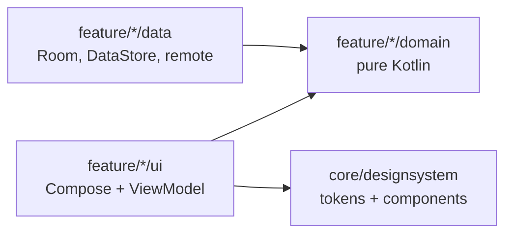

# Findora · Dream House

> Where comfort meets convenience. A production-minded Android rental app built with Kotlin and Jetpack Compose.

[](https://github.com/bileldh-ing/findora/actions/workflows/ci.yml)


Findora is built in small, verifiable phases. Every phase must compile and pass
`./gradlew check` (detekt, Spotless/ktlint, unit tests, Android Lint with warnings as errors)
before the next one starts. The [changelog](CHANGELOG.md) records what each phase delivered.

## Roadmap

| Phase | Scope | Status |
|---|---|---|
| 0 | Bootstrap: build system, design system, navigation, CI | Done |
| 1 | Data layer and property imagery | Next |
| 2 | Welcome and authentication | Planned |
| 3 | Home screen, pixel-faithful to the reference design | Planned |
| 4 | Property detail and viewing bookings | Planned |
| 5 | Best-match recommendations | Planned |
| 6 | Map, chat, settings, localisation (EN, FR, AR with RTL) | Planned |
| 7 | Pro extras | Planned |
| 8 | Polish and release | Planned |

## What Phase 0 ships

- **Build system**: Gradle Kotlin DSL, a single version catalog, KSP only (no kapt).
- **Design system** (`core/designsystem`): light and dark colour roles, a Syne + Poppins type scale,
  spacing, shape, elevation and motion tokens exposed through `CompositionLocal`s, plus a WCAG 2.1
  contrast helper with unit tests on the key text/background pairs.
- **Components**: pill buttons, category chips, glass chips, logo mark and badge.
- **App shell**: Hilt, type-safe Navigation Compose routes (kotlinx.serialization), Android 12
  splash screen back-ported to API 26, adaptive and themed launcher icon, edge-to-edge,
  predictive back, French and Arabic strings with RTL enabled.
- **Debug-only design-system showcase**, absent from release builds (covered by a test).
- **Quality gates**: detekt with Compose rules, Spotless/ktlint, Kover coverage,
  Android Lint with warnings as errors, and GitHub Actions CI that also builds an R8 release APK.

## Getting started

Requirements: JDK 17 and Android SDK 35.

```bash
git clone https://github.com/bileldh-ing/findora.git
cd findora
./gradlew :app:installDebug          # build and install on a running emulator or device
./gradlew check                      # detekt + spotlessCheck + unit tests + Android Lint
./gradlew :app:koverHtmlReportDebug  # coverage report
./gradlew spotlessApply              # auto-format
```

## Architecture

Single `:app` module organised package-by-feature; the reasoning is in
[ADR 0001](docs/adr/0001-single-module-package-by-feature.md).



```text
app/src/main/java/com/findora/app
├── core
│   ├── designsystem/theme      colours, type, tokens, contrast, FindoraTheme
│   ├── designsystem/component  pill buttons, chips, logo
│   └── di                      coroutine dispatchers module
├── feature
│   ├── bootstrap               themed landing screen
│   └── designsystem            debug-only component showcase
└── navigation                  type-safe routes and NavHost
```

## Tech stack

| Dependency | Why |
|---|---|
| Jetpack Compose (BOM) + Material 3 | UI toolkit; Material 3 is re-skinned from Findora tokens |
| Navigation Compose 2.8 | Type-safe routes via kotlinx.serialization |
| Hilt + KSP | Dependency injection without kapt |
| core-splashscreen | Android 12 splash API on API 26+ |
| Robolectric + Compose UI test | Compose UI tests on the JVM, in CI |
| detekt (+ Compose rules), Spotless/ktlint, Kover | Static analysis, formatting, coverage |

## Tests

| Suite | Covers |
|---|---|
| `DesignTokensTest` | Palette hex values, spacing/radius/motion scales, WCAG AA contrast of key pairs in light and dark |
| `FindoraNavHostTest` | Launch screen, debug showcase navigation and back, no showcase in release |

## Credits

Syne and Poppins are bundled under the SIL Open Font License 1.1 (see [`licenses/`](licenses)).
Code is released under the [MIT License](LICENSE).
