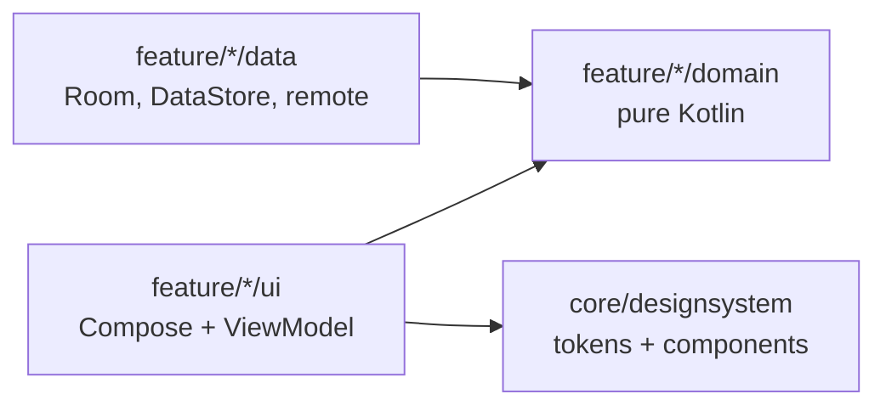

# Findora · Dream House

> Where comfort meets convenience. A production-minded Android rental app built with Kotlin and Jetpack Compose.

[](https://github.com/bileldh-ing/findora/actions/workflows/ci.yml)
[](https://github.com/bileldh-ing/findora/actions/workflows/release.yml)
[](https://github.com/bileldh-ing/findora/releases)


Findora is built in small, verifiable phases. Every phase must compile and pass
`./gradlew check` (detekt, Spotless/ktlint, unit tests, Android Lint with warnings as errors)
before the next one starts. The [changelog](CHANGELOG.md) records what each phase delivered.

## Roadmap

| Phase | Scope | Status |
|---|---|---|
| 0 | Bootstrap: build system, design system, navigation, CI | Done |
| 1 | Data layer and property imagery | Done |
| 2 | Welcome and authentication | Next |
| 3 | Home screen, pixel-faithful to the reference design | Planned |
| 4 | Property detail and viewing bookings | Planned |
| 5 | Best-match recommendations | Planned |
| 6 | Map, chat, settings, localisation (EN, FR, AR with RTL) | Planned |
| 7 | Pro extras | Planned |
| 8 | Polish and release | Planned |

## What Phase 1 ships

- **Domain** (`core/domain`, pure Kotlin, `@Immutable` models): `Property`, `PropertyType`, `Agent` with an
  initials avatar, `Amenity`, `PricePoint`, `Money`/`Currency` (INR, USD, EUR, TND, AED), `RegionPack`
  (Kerala default, Tunis, Paris, Dubai), settings, and repository interfaces.
- **Sample dataset**: 64 fictional listings (40 in Kerala, 8 each in Tunis, Paris and Dubai) in
  `app/src/main/assets/seed/`, including the four design listings (Georgie House, Max House, Luna Haven,
  The Serene Nest). Every listing is labelled `sampleData`; agents, phones and prices are invented.
- **Real photography**: 204 distinct Pexels photos (4 to 8 per listing, unique cover per listing), each
  verified at build time (HTTP 200, image content type, long side of at least 1200 px, not black and white,
  no duplicate bytes or near-duplicate dHash) with a dominant colour for instant placeholders.
  Credits in [CREDITS.md](CREDITS.md) and on every image in the seed. A 12-photo WebP offline pack
  (1.9 MB, max 1280 px, quality 85) backs every image so cards never render empty.
- **Data layer** (`core/data`): Room database with entities and DAOs for properties, per-user favourites,
  users, messages, saved searches, viewings (double booking blocked by a unique index), recent searches and
  interaction events, exported schemas in `app/schemas`; DataStore settings; `FakeRemoteDataSource` with
  150 to 600 ms latency and switchable error injection; offline-first repositories. See
  [ADR 0002](docs/adr/0002-offline-first-data-layer.md).
- **Images** (`core/image`): Coil 3 `ImageLoader` with a 250 MB disk cache, 25% memory cache, crossfade,
  OkHttp, and an interceptor that falls back to the bundled WebP when a remote load fails.
- **PriceFormatter**: design style `10.000/ Month`, plus locale-aware formats (lakh grouping for INR,
  French spacing for EUR/TND, Arabic conventions and RTL-safe isolation).

### Regenerating the seed

```bash
pip install pillow
python3 scripts/build_seed/build_seed.py                  # regenerate listings, regions, CREDITS.md
python3 scripts/build_seed/build_seed.py --refresh-photos  # re-download and re-verify every photo
python3 scripts/build_seed/build_seed.py --offline-pack    # rebuild the WebP offline pack
python3 scripts/build_seed/build_seed.py --check           # fail if committed outputs are stale
```

## What Phase 0 ships

- **Build system**: Gradle Kotlin DSL, a single version catalog, KSP only (no kapt).
- **Design system** (`core/designsystem`): light and dark colour roles, a Syne + Poppins type scale,
  spacing, shape, elevation and motion tokens exposed through `CompositionLocal`s, plus a WCAG 2.1
  contrast helper with unit tests on the key text/background pairs.
- **Components**: pill buttons, category chips, glass chips, logo mark and badge.
- **App shell**: Hilt, type-safe Navigation Compose routes (kotlinx.serialization), Android 12
  splash screen back-ported to API 26, adaptive and themed launcher icon, edge-to-edge,
  predictive back, French and Arabic strings with RTL enabled.
- **Debug-only design-system showcase**, absent from release builds (covered by a test).
- **Quality gates**: detekt with Compose rules, Spotless/ktlint, Kover coverage,
  Android Lint with warnings as errors, and GitHub Actions CI that also builds an R8 release APK.

## Getting started

Requirements: JDK 17 and Android SDK 35.

```bash
git clone https://github.com/bileldh-ing/findora.git
cd findora
./gradlew :app:installDebug          # build and install on a running emulator or device
./gradlew check                      # detekt + spotlessCheck + unit tests + Android Lint
./gradlew :app:koverHtmlReportDebug  # coverage report
./gradlew spotlessApply              # auto-format
```

## Architecture

Single `:app` module organised package-by-feature; the reasoning is in
[ADR 0001](docs/adr/0001-single-module-package-by-feature.md).



```text
app/src/main/java/com/findora/app
├── core
│   ├── designsystem/theme      colours, type, tokens, contrast, FindoraTheme
│   ├── designsystem/component  pill buttons, chips, logo
│   ├── common                  injectable clock
│   ├── domain                  models, repository interfaces, PriceFormatter (pure Kotlin)
│   ├── data                    Room, DataStore, seed DTOs, fake remote, repositories, Hilt modules
│   ├── image                   Coil ImageLoader and offline fallback
│   └── di                      coroutine dispatchers module
├── feature
│   ├── bootstrap               themed landing screen
│   └── designsystem            debug-only component showcase
└── navigation                  type-safe routes and NavHost
```

## Tech stack

| Dependency | Why |
|---|---|
| Jetpack Compose (BOM) + Material 3 | UI toolkit; Material 3 is re-skinned from Findora tokens |
| Navigation Compose 2.8 | Type-safe routes via kotlinx.serialization |
| Hilt + KSP | Dependency injection without kapt |
| core-splashscreen | Android 12 splash API on API 26+ |
| Room 2.6 (+ KSP, room-testing) | Local single source of truth with exported, migration-tested schemas |
| DataStore Preferences | Async, transactional settings storage that replaces SharedPreferences |
| kotlinx.serialization JSON | Seed and DTO parsing, JSON columns, type-safe routes |
| Kotlin Coroutines + Flow | Async work and reactive streams from Room to UI |
| Coil 3 (compose, network-okhttp) + OkHttp | Image loading with memory/disk cache and crossfade |
| Turbine, MockK, kotlinx-coroutines-test | Flow assertions, mocking and virtual-time coroutine tests |
| Robolectric + Compose UI test | Compose UI tests on the JVM, in CI |
| detekt (+ Compose rules), Spotless/ktlint, Kover | Static analysis, formatting, coverage |

## Tests

| Suite | Covers |
|---|---|
| `DesignTokensTest` | Palette hex values, spacing/radius/motion scales, WCAG AA contrast of key pairs in light and dark |
| `FindoraNavHostTest` | Launch screen, debug showcase navigation and back, no showcase in release |
| `SeedIntegrityTest` | 60+ listings, unique ids, valid fields, 4 to 8 credited images, coordinates inside region bounds, design listings, price history, offline pack size |
| `PriceFormatterTest` | Design style, INR lakh grouping, USD, EUR, TND, Arabic/RTL isolation |
| `DomainModelTest` | Money arithmetic, stable ids, bounds, filters |
| `PropertyDaoTest`, `UserDataDaoTest`, `ActivityDaoTest` | Every DAO against in-memory Room (Robolectric): filters, ordering, per-user favourites, unique e-mail, double-booking guard, recent-search de-duplication and trimming |
| `DatabaseSchemaTest` | Exported schema committed and identical to the entities (`MigrationTestHelper`) |
| `FakeRemoteDataSourceTest` | Latency window, paging, not found, fail-next / always / random error injection |
| `OfflineFirstPropertyRepositoryTest` | First load, TTL, forced refresh, failures keep the cache, filters |
| `RoomRepositoriesTest` | Favourites, search history, interactions, region packs |
| `DataStoreSettingsRepositoryTest` | Defaults and persistence of every setting |
| `OfflineFallbackInterceptorTest` | Fallback to the bundled WebP on failure, 250 MB disk cache |

## Credits

Property photos are from [Pexels](https://www.pexels.com/license/); every photographer is listed in
[CREDITS.md](CREDITS.md). Listings, agents and prices are fictional sample data.
Syne and Poppins are bundled under the SIL Open Font License 1.1 (see [`licenses/`](licenses)).
Code is released under the [MIT License](LICENSE).
