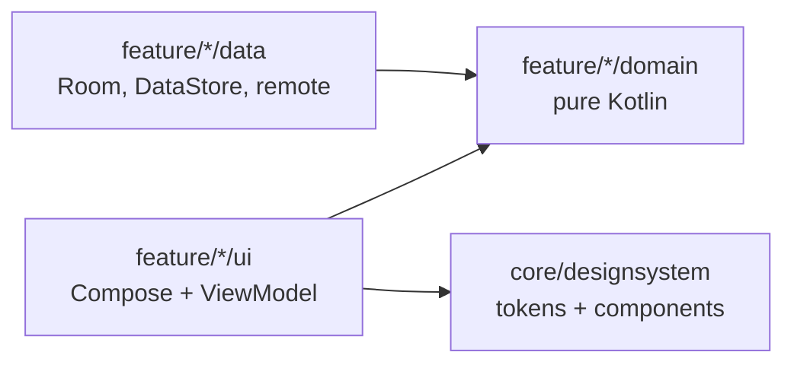

# Findora · Dream House

> Where comfort meets convenience. A production-minded Android rental app built with Kotlin and Jetpack Compose.

[](https://github.com/bileldh-ing/findora/actions/workflows/ci.yml)
[](https://github.com/bileldh-ing/findora/actions/workflows/release.yml)
[](https://github.com/bileldh-ing/findora/releases)


Findora is built in small, verifiable phases. Every phase must compile and pass
`./gradlew check` (detekt, Spotless/ktlint, unit tests, Android Lint with warnings as errors)
before the next one starts. The [changelog](CHANGELOG.md) records what each phase delivered.

## Roadmap

| Phase | Scope | Status |
|---|---|---|
| 0 | Bootstrap: build system, design system, navigation, CI | Done |
| 1 | Data layer and property imagery | Done |
| 2 | Welcome and authentication | Done |
| 3 | Home screen, pixel-faithful to the reference design | Done |
| 4 | Property detail and viewing bookings | Next |
| 5 | Best-match recommendations | Planned |
| 6 | Map, chat, settings, localisation (EN, FR, AR with RTL) | Planned |
| 7 | Pro extras | Planned |
| 8 | Polish and release | Planned |

## What Phase 3 ships

- **Home, as in the reference**: location pill (region picker), bell with an unread dot (notifications
  sheet, swipe to mark read), initials avatar, "Discover / Your New House", search pill with a filter badge,
  sliding category chips and a two-column grid of glass-chip cards. The title collapses as you scroll and a
  compact search bar pins to the top.
- **Paging 3 over Room**: the shared `PropertyFilter` becomes one parameterised SQL query
  (`PropertyQueryBuilder`, unit-tested clause by clause) behind a `@RawQuery` PagingSource. Pull to refresh,
  shimmer skeletons, empty, error and offline states.
- **Filters**: rent and area sliders bounded by the region's listings, bedrooms, bathrooms, furnished, pets,
  parking, verified, amenities and five sort orders; the badge counts active refinements.
- **Search** with 300 ms debounced suggestions and per-user recent searches (swipe to delete, clear all).
- **Favourites** per user: heart toggle, double-tap with a heart burst, and a Saved tab.
- **Floating navigation pill** (Home, Locations, Saved, Settings) with a sliding spring indicator.
  Locations is a region and neighbourhood picker until the map ships; Chat joins with Phase 6.
- Staggered card entrance and `animateItem`, all skipped when system animations are off; TalkBack reads one
  summary per card with Save as a custom action.

## What Phase 2 ships

- **Welcome**, faithful to the reference: full-bleed hero photo cut by a concave arc (`ConcaveArcShape`,
  `Path.quadraticTo`), logo badge, FINDORA / Dream House over a soft scrim, WELCOME in Syne, subtitle,
  Login and Sign Up pills, plus "Try demo account" and "Continue as guest". Ken Burns drift, a bouncy badge,
  staggered entrance and photo parallax on scroll, all skipped when system animations are off.
- **Login, Sign Up, Forgot password** with inline validation (e-mail format, password rules checklist,
  matching confirmation), "Remember me", a 5-failure / 30-second lockout with a live countdown, and a local
  reset-code flow (no e-mail is sent; the code is shown in-app).
- **Local auth** (`core/data/auth`, see [ADR 0003](docs/adr/0003-local-authentication.md)): PBKDF2WithHmacSHA256
  (16-byte salt, 120,000 iterations, constant-time compare), case-insensitive unique e-mail, persisted
  throttling (Room schema v2 auto-migration), session token encrypted with an Android Keystore AES-GCM key,
  30-day remembered sessions, guest sessions, the pre-seeded demo account `demo@findora.app` / `Demo1234`,
  logout and delete account (removes every row keyed by the user id).
- **Route guard**: a valid session at launch skips Welcome; with the biometric lock on, the app opens on an
  Unlock screen (`androidx.biometric`, fingerprint/face or screen lock).
- **Settings (first cut)**: account card, theme (system/light/dark, applied app-wide), biometric lock toggle,
  log out, delete account with confirmation (now the Settings tab).
- English, French and Arabic strings for everything; icons are a thin-stroke set drawn in code, with
  auto-mirroring for directional icons in RTL.

## What Phase 1 ships

- **Domain** (`core/domain`, pure Kotlin, `@Immutable` models): `Property`, `PropertyType`, `Agent` with an
  initials avatar, `Amenity`, `PricePoint`, `Money`/`Currency` (INR, USD, EUR, TND, AED), `RegionPack`
  (Kerala default, Tunis, Paris, Dubai), settings, and repository interfaces.
- **Sample dataset**: 64 fictional listings (40 in Kerala, 8 each in Tunis, Paris and Dubai) in
  `app/src/main/assets/seed/`, including the four design listings (Georgie House, Max House, Luna Haven,
  The Serene Nest). Every listing is labelled `sampleData`; agents, phones and prices are invented.
- **Real photography**: 204 distinct Pexels photos (4 to 8 per listing, unique cover per listing), each
  verified at build time (HTTP 200, image content type, long side of at least 1200 px, not black and white,
  no duplicate bytes or near-duplicate dHash) with a dominant colour for instant placeholders.
  Credits in [CREDITS.md](CREDITS.md) and on every image in the seed. A 12-photo WebP offline pack
  (1.9 MB, max 1280 px, quality 85) backs every image so cards never render empty.
- **Data layer** (`core/data`): Room database with entities and DAOs for properties, per-user favourites,
  users, messages, saved searches, viewings (double booking blocked by a unique index), recent searches and
  interaction events, exported schemas in `app/schemas`; DataStore settings; `FakeRemoteDataSource` with
  150 to 600 ms latency and switchable error injection; offline-first repositories. See
  [ADR 0002](docs/adr/0002-offline-first-data-layer.md).
- **Images** (`core/image`): Coil 3 `ImageLoader` with a 250 MB disk cache, 25% memory cache, crossfade,
  OkHttp, and an interceptor that falls back to the bundled WebP when a remote load fails.
- **PriceFormatter**: design style `10.000/ Month`, plus locale-aware formats (lakh grouping for INR,
  French spacing for EUR/TND, Arabic conventions and RTL-safe isolation).

### Regenerating the seed

```bash
pip install pillow
python3 scripts/build_seed/build_seed.py                  # regenerate listings, regions, CREDITS.md
python3 scripts/build_seed/build_seed.py --refresh-photos  # re-download and re-verify every photo
python3 scripts/build_seed/build_seed.py --offline-pack    # rebuild the WebP offline pack
python3 scripts/build_seed/build_seed.py --check           # fail if committed outputs are stale (offline, runs in CI)
```

## What Phase 0 ships

- **Build system**: Gradle Kotlin DSL, a single version catalog, KSP only (no kapt).
- **Design system** (`core/designsystem`): light and dark colour roles, a Syne + Poppins type scale,
  spacing, shape, elevation and motion tokens exposed through `CompositionLocal`s, plus a WCAG 2.1
  contrast helper with unit tests on the key text/background pairs.
- **Components**: pill buttons, category chips, glass chips, logo mark and badge.
- **App shell**: Hilt, type-safe Navigation Compose routes (kotlinx.serialization), Android 12
  splash screen back-ported to API 26, adaptive and themed launcher icon, edge-to-edge,
  predictive back, French and Arabic strings with RTL enabled.
- **Debug-only design-system showcase**, absent from release builds (covered by a test).
- **Quality gates**: detekt with Compose rules, Spotless/ktlint, Kover coverage,
  Android Lint with warnings as errors, and GitHub Actions CI that also builds an R8 release APK.

## Getting started

Requirements: JDK 17 and Android SDK 35.

```bash
git clone https://github.com/bileldh-ing/findora.git
cd findora
./gradlew :app:installDebug          # build and install on a running emulator or device
./gradlew check                      # detekt + spotlessCheck + unit tests + Android Lint
./gradlew :app:koverHtmlReportDebug  # coverage report
./gradlew spotlessApply              # auto-format
```

## Architecture

Single `:app` module organised package-by-feature; the reasoning is in
[ADR 0001](docs/adr/0001-single-module-package-by-feature.md).



```text
app/src/main/java/com/findora/app
├── core
│   ├── designsystem/theme      colours, type, tokens, contrast, FindoraTheme
│   ├── designsystem/component  pill buttons, chips, logo, text fields, arc shape, controls
│   ├── designsystem/icon       thin-stroke icon set (ImageVector)
│   ├── common                  injectable clock
│   ├── domain                  models, repository interfaces, PriceFormatter (pure Kotlin)
│   ├── data                    Room, DataStore, seed DTOs, fake remote, repositories, Hilt modules
│   ├── data/auth               password hashing, Keystore session cipher, local AuthRepository
│   ├── security                biometric availability
│   ├── image                   Coil ImageLoader and offline fallback
│   ├── ui                      property card, state views, swipe-to-delete row
│   └── di                      coroutine dispatchers module
├── feature
│   ├── auth                    welcome, login, sign up, forgot password, biometric unlock
│   ├── home                    header, paged grid, filter, region and notification sheets
│   ├── search                  debounced suggestions and recent searches
│   ├── saved                   saved homes
│   ├── locations               region and neighbourhood picker
│   ├── settings                account, theme, biometric lock, logout, delete account
│   └── designsystem            debug-only component showcase
└── navigation                  type-safe routes, NavHost, route guard, main shell and floating nav pill
```

## Tech stack

| Dependency | Why |
|---|---|
| Jetpack Compose (BOM) + Material 3 | UI toolkit; Material 3 is re-skinned from Findora tokens |
| Navigation Compose 2.8 | Type-safe routes via kotlinx.serialization |
| Hilt + KSP | Dependency injection without kapt |
| core-splashscreen | Android 12 splash API on API 26+ |
| Room 2.6 (+ KSP, room-testing) | Local single source of truth with exported, migration-tested schemas |
| DataStore Preferences | Async, transactional settings storage that replaces SharedPreferences |
| kotlinx.serialization JSON | Seed and DTO parsing, JSON columns, type-safe routes |
| Kotlin Coroutines + Flow | Async work and reactive streams from Room to UI |
| Coil 3 (compose, network-okhttp) + OkHttp | Image loading with memory/disk cache and crossfade |
| androidx.biometric | Fingerprint, face or screen-lock prompt for the optional app lock |
| Paging 3 (runtime, compose, room-paging, paging-testing) | Incremental loading of the Home feed straight from Room, `LazyPagingItems` in the grid, `asSnapshot` in tests |
| Turbine, MockK, kotlinx-coroutines-test | Flow assertions, mocking and virtual-time coroutine tests |
| Robolectric + Compose UI test | Compose UI tests on the JVM, in CI |
| detekt (+ Compose rules), Spotless/ktlint, Kover | Static analysis, formatting, coverage |

## Tests

| Suite | Covers |
|---|---|
| `DesignTokensTest` | Palette hex values, spacing/radius/motion scales, WCAG AA contrast of key pairs in light and dark |
| `FindoraNavHostTest` | Launch screen, debug showcase navigation and back, no showcase in release |
| `SeedIntegrityTest` | 60+ listings, unique ids, valid fields, 4 to 8 credited images, coordinates inside region bounds, design listings, price history, offline pack size |
| `PriceFormatterTest` | Design style, INR lakh grouping, USD, EUR, TND, Arabic/RTL isolation |
| `DomainModelTest` | Money arithmetic, stable ids, bounds, filters |
| `PropertyDaoTest`, `UserDataDaoTest`, `ActivityDaoTest` | Every DAO against in-memory Room (Robolectric): filters, ordering, per-user favourites, unique e-mail, double-booking guard, recent-search de-duplication and trimming |
| `DatabaseSchemaTest` | Exported schemas committed and identical to the entities; v1 to v2 migration keeps data (`MigrationTestHelper`) |
| `FakeRemoteDataSourceTest` | Latency window, paging, not found, fail-next / always / random error injection |
| `OfflineFirstPropertyRepositoryTest` | First load, TTL, forced refresh, failures keep the cache, filters |
| `RoomRepositoriesTest` | Favourites, search history, interactions, region packs |
| `DataStoreSettingsRepositoryTest` | Defaults and persistence of every setting |
| `OfflineFallbackInterceptorTest` | Fallback to the bundled WebP on failure, 250 MB disk cache |
| `PasswordHasherTest` | PBKDF2 parameters (>= 120k iterations, 16-byte salt), unique salts, wrong passwords, malformed hashes |
| `CredentialValidatorTest` | E-mail normalisation and format, password rules, names, initials |
| `AuthRepositoryTest` | Sign-up, case-insensitive duplicates, lockout with a fake clock (and across restarts), remembered and process-only sessions, expiry, demo, guest, reset codes, delete account |
| `EncryptedSessionStoreTest` | Round trip, no plaintext on disk, undecryptable data treated as signed out |
| `AuthViewModelsTest` | Login (validation, attempts left, lockout countdown), sign-up, forgot password, welcome (Turbine) |
| `SettingsViewModelTest`, `AppViewModelTest` | Theme, biometric rules, logout/delete; launch route guard |
| `AuthScreensTest` | Welcome content and buttons, light/dark, login and sign-up inline validation (Compose, Robolectric) |
| `PropertyQueryBuilderTest` | Every filter clause, bound arguments, LIKE escaping, sort tie-breakers |
| `PropertySearchDaoTest` | Room + Paging 3 feed across pages, category/text/refinements in SQL, price sorts, bounds, suggestions |
| `HomeViewModelTest`, `SearchViewModelTest`, `SavedAndLocationsViewModelTest` | Header, refresh states, category paging, favourites per user, filter reset between users, regions, notifications; debounced suggestions, submit, per-user recents; saved list; locations (Turbine) |
| `HomeDataRepositoriesTest` | Unread messages per user and mark-read, recent-search delete, Home filter ownership |
| `HomeScreenTest`, `SearchAndTabsScreenTest` | Reference header, chips filtering the grid, favourite toggle and TalkBack action, filter sheet and badge, empty/error/offline states, notifications, search, nav pill, Saved, Locations (Compose, Robolectric) |
| `MainActivitySmokeTest` (instrumented) | Real launch with Hilt and Keystore; guest journey Welcome to Home, chip filter, tabs, Settings and back |

## Credits

Property photos are from [Pexels](https://www.pexels.com/license/); every photographer is listed in
[CREDITS.md](CREDITS.md). Listings, agents and prices are fictional sample data.
The Welcome hero photo is [Black Wooden House Under Blue Sky](https://www.pexels.com/photo/black-wooden-house-under-blue-sky-5766483/)
by [Eva Bronzini](https://www.pexels.com/@eva-bronzini/) (Pexels License).
Syne and Poppins are bundled under the SIL Open Font License 1.1 (see [`licenses/`](licenses)).
Code is released under the [MIT License](LICENSE).
